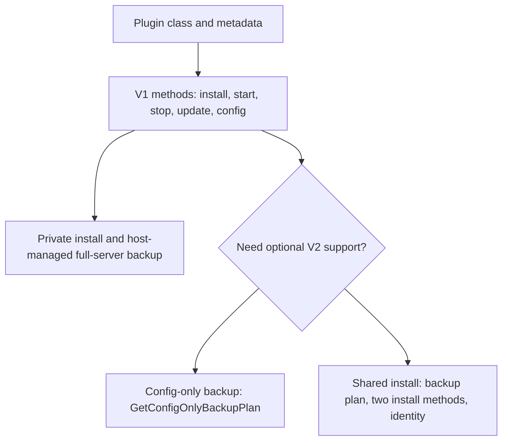
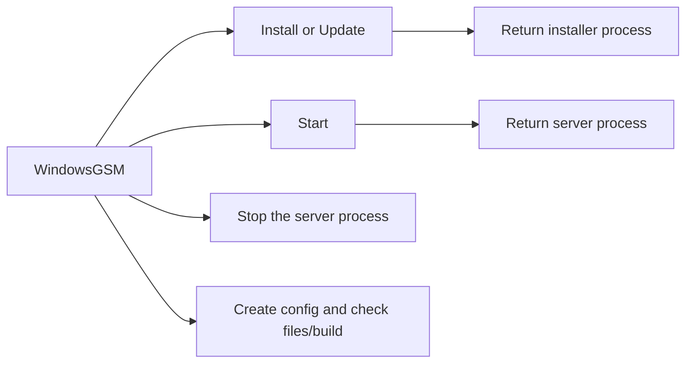
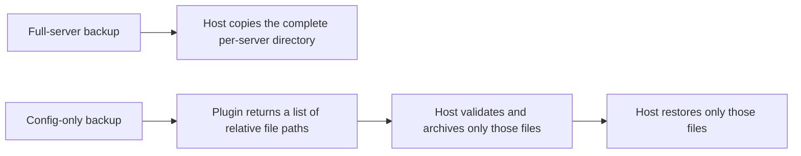
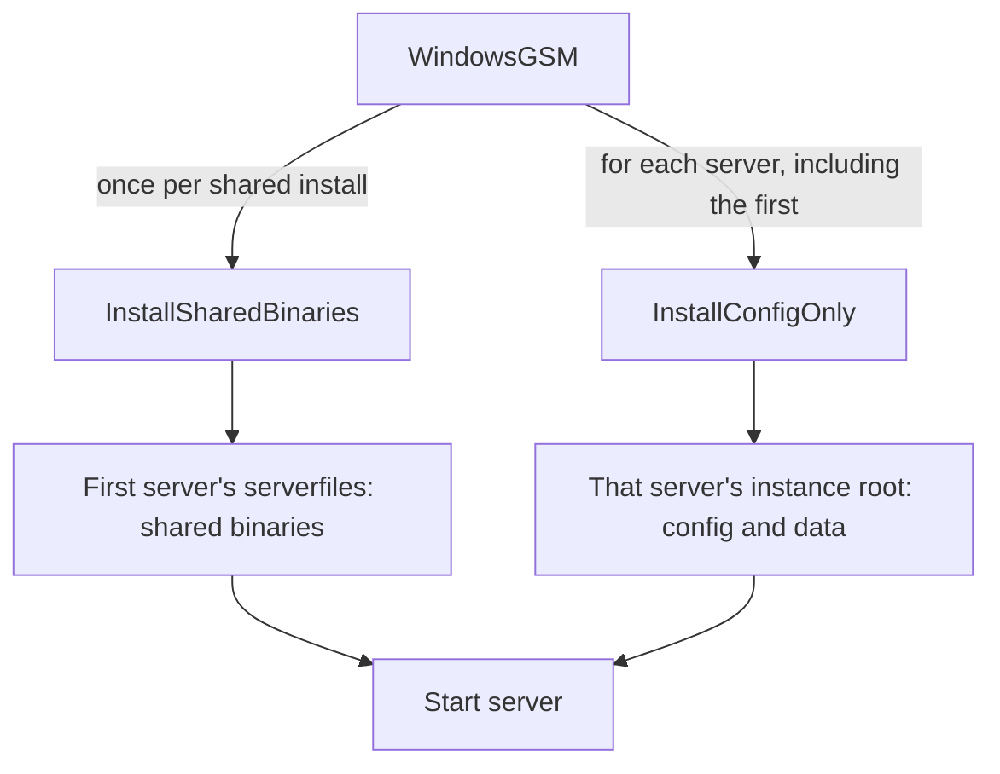

# Write a WindowsGSM plugin from scratch

This tutorial builds a complete plugin without deriving from `Source`, `GoldSource`, or any other game-engine class. A plugin is a C# class compiled by WindowsGSM at runtime; it supplies the game-specific install, process, configuration, and update behavior itself.

The accompanying [`CS16StandaloneV2.cs` example](../Examples/CS16StandaloneV2.cs) has [companion sample notes](examples/CS16StandaloneV2.md) and is a compile-tested, no-engine-base reference. It targets Counter-Strike 1.6 to show a GoldSrc-style dedicated executable and config layout. Counter-Strike 1.6 is already built into this fork, so treat that file as a learning/reference sample rather than installing it as a duplicate game entry. The patterns also apply to a genuinely unsupported game.

## The two plugin layers

Start with the V1 methods every plugin uses. Once that works, add only the V2 capability you need. “V1 base methods” means the baseline plugin methods below; it does **not** mean inheriting from a WindowsGSM engine class.



## 1. Understand the plugin contract

The loader expects one source file per plugin, named to match the public class, under:

```text
plugins\<PluginName>.cs\<PluginName>.cs
```

The class must be public, non-abstract, live in `WindowsGSM.Plugins`, and have a public constructor that accepts `ServerConfig`. Keep the public `Plugin` metadata and the lifecycle members WindowsGSM calls. There is no required engine base class or plugin interface, and V2 is inferred from optional methods rather than a version marker.

The plugin is trusted in-process code, not sandboxed. It runs with the application's permissions and must report failures through its `Error` field/property and operation results; it must not pretend an operation succeeded when a process or file operation failed.

## 2. Set up the development project

1. Install Visual Studio with the .NET 10 SDK and Desktop development workload.
2. Clone or download the **complete** repository and open `CdogsWindowsGSM.sln`.
3. Build `CdogsWindowsGSM` in Debug or Release. The plugin-development helper requires the matching app output, for example `CdogsWindowsGSM\bin\Debug\net10.0-windows10.0.19041\win-x64\CdogsWindowsGSM.exe`.
4. Use the `CdogsWindowsGSM-Plugin-Development` project for the examples and to copy your finished source into the app's plugin folder.

WindowsGSM compiles plugin source with C# 7.3 syntax against the .NET 10 runtime and application assembly. Avoid newer language syntax and .NET Framework-only APIs in loaded plugin source.

## 3. First, write down four game facts

Keep this simple. Read the game's dedicated-server instructions and answer these questions before coding:

| Find out | You will use it for |
|---|---|
| How are server files installed, and what installer/app ID is used? | `Install()` and `Update()` |
| Which executable starts the server, from which working folder, and with what arguments? | `Start()` |
| Which files hold config, saves, and logs, and which belong to one server? | `CreateServerCFG()`, backup plans, and any later shared install |
| How does the server stop, and how can you check its files/version? | `Stop()`, validation, and build methods |

For the first version, keep the install private to each server. Do not add shared installation until you know exactly which files can be shared and which must remain per-server.

## 4. Define a class with no game-engine base type

Start with a public class in the required namespace. In the sample, `CS16StandaloneV2` inherits only from the implicit `object` base class:

```csharp
namespace WindowsGSM.Plugins
{
	public class CS16StandaloneV2
	{
		private readonly ServerConfig _serverData;

		public Plugin Plugin = new Plugin
		{
			name = "WindowsGSM.CS16StandaloneV2",
			author = "Your name",
			description = "Standalone Counter-Strike 1.6 plugin tutorial",
			version = "1.0",
			url = "",
			color = "#ffffff"
		};

		public CS16StandaloneV2(ServerConfig serverData)
		{
			_serverData = serverData;
		}

		// Add the game's public properties and lifecycle methods here.
	}
}
```

The filename must be `CS16StandaloneV2.cs` because the loader looks for `WindowsGSM.Plugins.CS16StandaloneV2`. `Plugin.name` is display metadata; it does not replace the class/file naming rule. The complete source is in `Examples` so you can compare each section below to a compilable implementation.

## 5. Declare settings and metadata WindowsGSM reads

The example declares its executable, display name, ports, query method, defaults, and error fields directly. These are ordinary public members, not inherited engine behavior:

```csharp
public string Error;
public string Notice;
public string StartPath = "hlds.exe";
public string FullName = "Counter-Strike 1.6 (standalone plugin tutorial)";
public bool AllowsEmbedConsole = false;
public int PortIncrements = 1;
public object QueryMethod = new A2S();
public string Game = "cstrike";
public string Port = "27015";
public string QueryPort = "27015";
public string Defaultmap = "de_dust2";
public string Maxplayers = "24";
public string Additional = string.Empty;
```

Choose a unique `FullName` for a new game. Do not use the exact name of a game already built into WindowsGSM unless you are intentionally replacing/testing that integration in an isolated development setup. Select the query implementation only if the game actually supports that protocol; otherwise use `null`.

## 6. Implement the V1 methods first

There is no engine base class doing this work for you. Your class supplies the baseline V1 methods WindowsGSM calls:



| Member | Typical signature | Responsibility |
|---|---|---|
| Install | `Task<Process> Install()` | Download/install into this server's private `serverfiles` folder and return the installer process for host monitoring. |
| Start | `Task<Process> Start()` | Validate required files, launch the game executable with the instance's settings, and return the running process. |
| Stop | `Task Stop(Process process)` | Send the game's documented graceful-stop command. WindowsGSM applies its normal stop timeout/fallback if the process remains alive. |
| Update | `Task<Process> Update(bool validate = false, string custom = null)` | Start and return the update process; set `Error` and return `null` if it cannot start. |
| Install validation | `bool IsInstallValid()` | Check the expected executable/data actually exists in the selected install root. |
| Import validation | `bool IsImportValid(string path)` | Confirm that the selected directory contains the required executable and data. |
| Build info | `string GetLocalBuild()` / `Task<string> GetRemoteBuild()` | Return a comparable version/build identifier, or an empty value with an explicit diagnostic when unavailable. |
| Default config | `void CreateServerCFG()` | Create initial config/data for this instance without overwriting user edits on repeated calls. |

These are public methods and properties the host finds by name/signature, not members inherited from a required interface. Keep the plugin's `Error` field/property useful: when an operation fails, set an actionable message and return the failure value expected by that method.

The complete example uses SteamCMD's GoldSrc dedicated-server app ID `90` with mod `cstrike`; `10` is the Counter-Strike game app ID written to `steam_appid.txt`. Keep these identities distinct when adapting Steam games. Its `Start` launches `hlds.exe -console -game cstrike` from the server's private root and supplies the selected port, player count, and map. Its `Stop` sends GoldSrc's `quit` command through WindowsGSM's console helper. Replace these details with the game's documented process behavior; command-line flags and graceful-stop commands are not universal.

The sample uses WindowsGSM's `SteamCMD` helper for install/update and build lookup. A non-Steam game should use its official downloader or installer instead. Return the real installer/update `Process` when one is started, so the host can track completion; do not return a made-up successful process or suppress an error.

Without any V2 methods, the plugin is V1: it uses private installs and the host's full-server backup. The host copies the complete per-server directory; it does not ask the plugin to make that backup.

## 7. Add optional V2 features after V1 works

V2 methods are optional. WindowsGSM recognizes the exact public method signatures; no version attribute or marker interface is needed. You can add config-only backup without enabling shared installation.

### Full-server and config-only backups

These are two different backup choices:



- **Full-server:** host-managed copy of the complete server directory. It works without any plugin backup method and remains the V1/default path.
- **Config-only:** opt-in V2 `.wgsmbackup` archive for selected per-instance configuration files. The plugin lists paths; the host reads them, creates the archive, and restores only those paths.

To enable config-only backup, implement the exact public method signature `PluginBackupPlan GetConfigOnlyBackupPlan(PluginInstanceContext context)`.

The example creates `cstrike\server.cfg` and `cstrike\mapcycle.txt` beneath the per-server `serverfiles` root. Its method declares those same files and does not read or archive them itself:

The example creates each file only if absent so later config generation does not erase server-owner edits.

```csharp
public PluginBackupPlan GetConfigOnlyBackupPlan(PluginInstanceContext context)
{
	if (context == null)
	{
		throw new ArgumentNullException(nameof(context));
	}
	if (!context.ApprovedRoots.ContainsKey("serverfiles"))
	{
		throw new InvalidOperationException("The host did not approve the serverfiles backup root.");
	}

	return new PluginBackupPlan(new[]
	{
		new ConfigurationBackupPath("serverfiles", Path.Combine("cstrike", "server.cfg")),
		new ConfigurationBackupPath("serverfiles", Path.Combine("cstrike", "mapcycle.txt"))
	});
}
```

Use only root IDs from `context.ApprovedRoots` and relative paths under them. The host currently approves the per-instance `serverfiles` root for plugins. The host validates the plan and owns archive creation and restore. Config-only archives are **not encrypted**; do not list files containing passwords or other secrets unless you accept that exposure.

### Shared installations

A shared installation keeps one copy of binaries while every server keeps its own writable files:



To advertise this capability, the plugin must provide **all three exact public method signatures** and public string identity members. A shared-install plugin must also provide `GetConfigOnlyBackupPlan` under the current host policy:

- `PluginBackupPlan GetConfigOnlyBackupPlan(PluginInstanceContext context)`
- `Task<Process> InstallSharedBinaries(SharedInstallationContext context)`
- `Task<SharedInstallationOperationResult> InstallConfigOnly(ServerInstanceContext context)`

The v2 API does not change the regular `Start`, `Install`, or `Update` return contract: those still use `Task<Process>`. `InstallSharedBinaries` uses the same process contract so WindowsGSM can monitor an installer process. `InstallConfigOnly` returns `Task<SharedInstallationOperationResult>` because setup is a terminal operation that may succeed, be cancelled, or fail without starting a process.

The methods have separate jobs:

- `InstallSharedBinaries` runs when the host creates a shared install. Use `context.InstallationRoot` for binaries and return the installer `Process` for WindowsGSM to monitor. Return `null` only when the operation completed without a process or failed; set the plugin's normal `Error` value on failure so the host can report it.
- `InstallConfigOnly` runs once per server using the shared install, including the first. Use `context.InstanceRoot` for that server's config/data. For the first server, this is the same `serverfiles` directory as `InstallationRoot`; later linked servers have their own `serverfiles` directory. Do not install, update, or modify shared binaries in this method. Return `Succeeded()`, `Cancelled(message)`, or `Failed(message)` to report the result clearly.
- `GetConfigOnlyBackupPlan` lists the per-instance config files for config-only backup. It does not create the backup archive.

The plugin also needs a public string `SharedInstallationAppId` or `AppId`, and a public string `SharedInstallationExecutableName` or `StartPath`. The executable value is a filename in the first server's `serverfiles` root, not a path. Full-server backup of that owner includes the shared binaries; WindowsGSM blocks a full restore of the owner while linked servers still use them.

| Plugin shape | Result |
|---|---|
| No V2 methods | V1 private install; host full-server backup. |
| `GetConfigOnlyBackupPlan` only | Private install; full-server and config-only backups. |
| `GetConfigOnlyBackupPlan` plus both shared-install methods and identity members | Config-only backup and shared-install capability. |

Do not add shared installation just because a game uses SteamCMD or has an executable. First prove that two servers can run together without sharing config, saves, logs, ports, or other mutable state. Test update impact and failure recovery too. The CS16 sample provides only `GetConfigOnlyBackupPlan`; it deliberately does **not** claim shared-install support.

## 8. Compare several useful game patterns

These are reference patterns, not instructions to duplicate built-in entries. For each title, the lifecycle must be implemented directly if you choose not to inherit from an engine class:

| Game/pattern | What a no-base plugin must handle | Useful paths/identity to investigate |
|---|---|---|
| Counter-Strike 1.6 (GoldSrc) | SteamCMD install with mod name; launch `hlds.exe`; implement GoldSrc's stop command and A2S query. | `cstrike\server.cfg`, `cstrike\mapcycle.txt`; SteamCMD app ID `90`, game app ID `10`. Full sample: [`CS16StandaloneV2.cs`](../Examples/CS16StandaloneV2.cs). |
| Left 4 Dead 2 (Source) | Launch `srcds.exe` with `-game left4dead2`; implement Source-specific config selection, map rotation, process handling, and update/install. | Steam dedicated-server app ID `222860`; instance config normally under `left4dead2\cfg\server.cfg` and mapcycle under the game folder. Do not copy a Garry's Mod `Game` path or assume the same flags cover every Source title. |
| Rust (Unity dedicated server) | Launch `RustDedicated.exe`; pass server-specific port, query port, hostname, level, and a unique server identity. Use the actual Rust SteamCMD app ID (`258550`) for installation/build calls. | Inspect the existing [`RUST.cs`](../../CdogsWindowsGSM/GameServer/RUST.cs) implementation for WindowsGSM-specific config handling. Keep world/save identity, config, and working directory unique per server. Do not assume Unity means the server can share writable files. |
| 7 Days to Die (Unity dedicated server) | Launch `7DaysToDieServer.exe`; implement its XML/config, server arguments, and game-specific stop/update behavior. | Inspect `serverconfig.xml`, save/world locations, and the server's SteamCMD installation before defining backup paths. |
| Minecraft Paper (Java server, not SteamCMD) | Locate Java, install/update the jar, handle EULA/setup explicitly, launch `java.exe -jar paper.jar nogui`, and stop through the documented console command. | `server.properties`, `eula.txt`, world/save data, Java arguments, and a per-instance working directory. Do not use a SteamCMD app ID for this distribution. |
| OpenTTD (standalone distribution) | Install/update the correct binary/assets, start with its documented config/data directory, and handle its own shutdown/version semantics. | Treat config, saves, and downloaded base graphics as different data classes; do not guess that all files belong in a config-only backup. |

### Rust: a Unity dedicated server

Rust does not need a WindowsGSM Unity base class. A standalone plugin owns the same operations as the Counter-Strike example, but its process is different: `RustDedicated.exe`, Rust's `+server.*` options, and a per-instance working directory/identity. The following is a `Start`-body sketch, not a complete plugin:

```csharp
string instanceRoot = ServerPath.GetServersServerFiles(_serverData.ServerID);
string executablePath = Path.Combine(instanceRoot, "RustDedicated.exe");
var arguments = new StringBuilder("-batchmode -nographics -silent-crashes");
AppendOption(arguments, "+server.port", _serverData.ServerPort);
AppendOption(arguments, "+server.queryport", _serverData.ServerQueryPort);
AppendOption(arguments, "+server.maxplayers", _serverData.ServerMaxPlayer);
AppendOption(arguments, "+server.identity", _serverData.ServerID);
arguments.Append(" +server.level \"Procedural Map\"");

var process = new Process
{
	StartInfo =
	{
		WorkingDirectory = instanceRoot,
		FileName = executablePath,
		Arguments = arguments.ToString(),
		UseShellExecute = false
	},
	EnableRaisingEvents = true
};
process.Start();
```

In a real plugin, check `File.Exists`, catch and report the expected process-start failures through `Error`, and return the started process. Install/update with Rust's dedicated-server app ID `258550`. If you load a `server.cfg`, confirm the format and working directory against the game's documentation; the built-in [`RUST.cs`](../../CdogsWindowsGSM/GameServer/RUST.cs) illustrates this fork's current config argument handling. Never reuse the same mutable save/config identity across servers. Rust config may contain an RCON password, so do not include that file in an unencrypted config-only archive without explicitly accepting the secret exposure.

### Left 4 Dead / Left 4 Dead 2: Source executable, no `Source` inheritance

For a standalone Left 4 Dead 2 plugin, declare `StartPath = "srcds.exe"`, `Game = "left4dead2"`, and the server app ID `222860` yourself. Resolve `srcds.exe` under the instance's private installation root and launch it with `-console -game left4dead2`, the configured IP/port/player count, and the selected map. Its instance config normally lives at `left4dead2\cfg\server.cfg`; map rotation is a separate `left4dead2\mapcycle.txt` file. Original Left 4 Dead uses the `left4dead` game folder and its own dedicated-server app ID; do not copy the L4D2 identity or paths. If the game's launch context does not discover those files automatically, pass explicit config/mapcycle paths using the game's documented command-line options.

Implement its install/update calls and `GetLocalBuild`/`GetRemoteBuild` independently as well. Use an A2S query method only if the server's query endpoint responds as expected, and verify the graceful-stop command for the exact L4D/L4D2 server build. Do not inherit `Source` merely because it happens to share `srcds.exe`; that base class also contains WindowsGSM lifecycle assumptions, process flags, and path rules.

The existing built-in integrations and external plugins are valuable research references, but use their game documentation to validate the behavior rather than transplanting their implementation wholesale. A shared engine family does not guarantee identical executable arguments, writable paths, config formats, or stop behavior.

## 9. Build, load, and test safely

1. Build `CdogsWindowsGSM-Plugin-Development`. It compiles the example source against the host assembly.
2. For a genuinely new game, adapt the example, rename the `.cs` file/class together, and place only the plugin source you intend to test at the top level of `CdogsWindowsGSM-Plugin-Development\Plugins`. The helper copies every top-level `*.cs` file in that directory.
3. Build the matching `CdogsWindowsGSM` Debug/Release output. Run `CdogsWindowsGSM-Plugin-Development` to copy plugins into `CdogsWindowsGSM\bin\<configuration>\net10.0-windows10.0.19041\win-x64\plugins\<Name>.cs\<Name>.cs`.
4. Run WindowsGSM and confirm the plugin loads in the Plugins log. Test installation and import validation, start with the expected working directory and arguments, graceful stop, update/error reporting, config generation, and query status in a disposable server-data root.
5. If you implement `GetConfigOnlyBackupPlan`, create and restore a config-only backup and verify only the declared files change. Test secrets exposure and restore behavior. Test two simultaneous servers, update impact, and failure recovery before advertising shared installation.

The standalone Counter-Strike example is compile-tested and checks its inferred config-backup capability. It is not a live game-server qualification and should not be installed over the built-in Counter-Strike 1.6 entry.

## Related plugin references

- [V1-to-V2 migration guide](PLUGIN-V1-TO-V2-GUIDE.md) — adds optional capabilities to an existing plugin; its Garry's Mod sample deliberately uses the Source base class.
- [Plugin API v2 plan](PLUGIN-API-V2-PLAN.md) — exact host signatures, responsibilities, and implementation/status details.
- [Compilation cache plan](PLUGIN-COMPILATION-CACHING-PLAN.md) — runtime compilation and cache behavior.
- [`Skeleton.cs`](../Examples/Skeleton.cs) and [`SkeletonV2.cs`](../Examples/SkeletonV2.cs) — minimal lifecycle and config-backup shapes.
